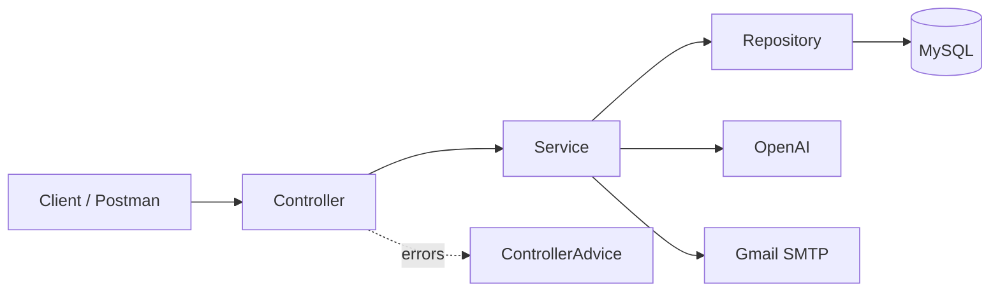
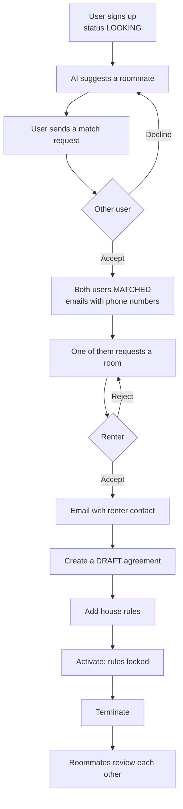
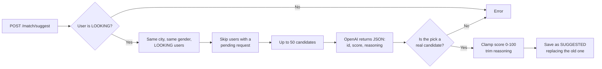
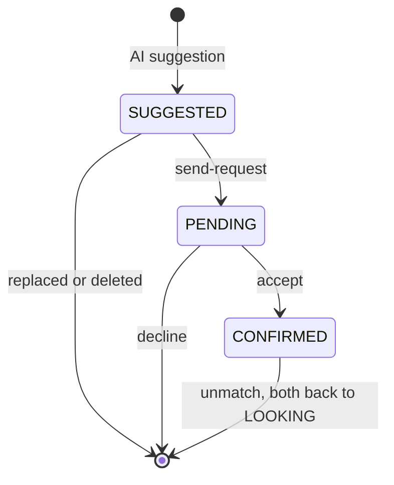
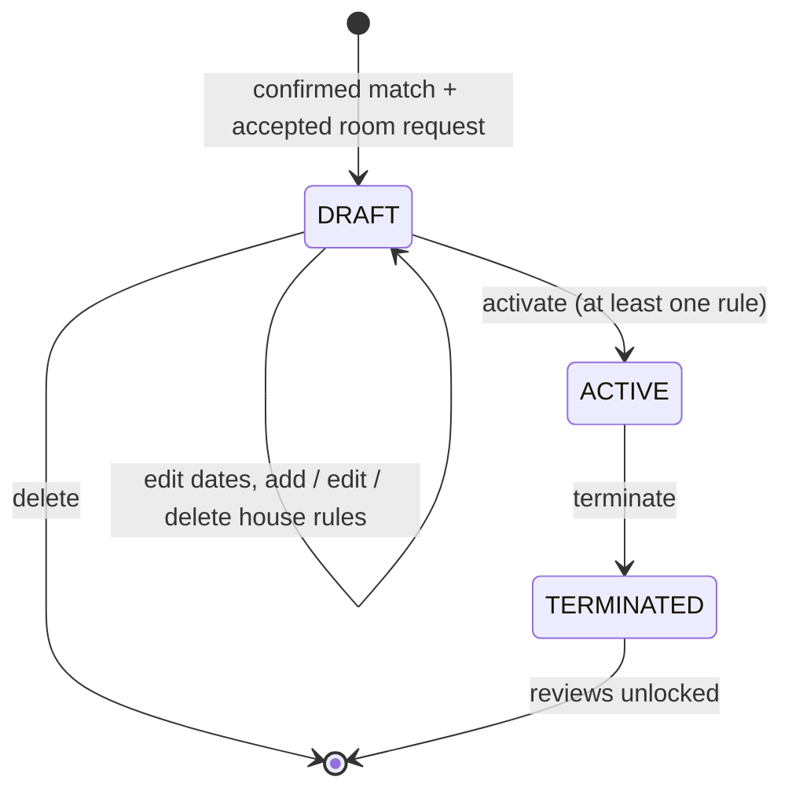
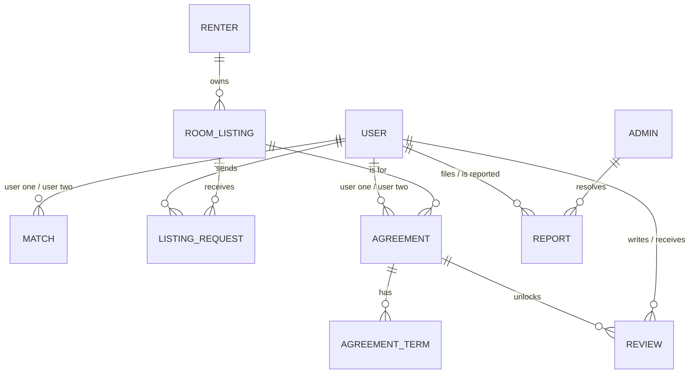

<p align="center">
  
</p>
<div align="center">

# 🏠 Rifqa · رفقة

**Find a roommate who fits your life.**

منصة ذكية تساعدك تلقى شريك سكن يناسب أسلوب حياتك، وتلقى الغرفة، وتكتب قوانين البيت قبل ما تسكن


</div>

---

Rifqa (رفقة) is an AI-powered roommate matching REST API. Students and young professionals moving to a new city get matched with a compatible roommate based on lifestyle, find an affordable room, and sign a written agreement with clear house rules. After the agreement ends, roommates review each other so the next person knows who to trust.

> Capstone 2 — Web Application Development by Java
> By **Turki Alghamdi** · Instructor: **Majd Alzahrani**

## 📑 Table of Contents

- [The Problem](#-the-problem)
- [Features](#-features)
- [Tech Stack](#️-tech-stack)
- [Integrations](#-integrations)
- [Architecture](#️-architecture)
- [The Rifqa Journey](#-the-rifqa-journey)
- [How AI Matching Works](#-how-ai-matching-works)
- [Agreement Lifecycle](#-agreement-lifecycle)
- [Data Model](#️-data-model)
- [Business Rules](#-business-rules)
- [Project Structure](#-project-structure)
- [Getting Started](#-getting-started)
- [Try It in Postman](#-try-it-in-postman)
- [API Overview](#-api-overview)
- [Extra Endpoints](#-extra-endpoints)
- [Error Handling](#-error-handling)

## 🤔 The Problem

| Before Rifqa | With Rifqa |
|---|---|
| A roommate from a group chat, matched by luck | An AI match on lifestyle in the same city, with a score and the reasons |
| Scrolling posts and waiting on calls to find a room | Search available rooms by city or budget, and get an email when accepted |
| Rent, guests and cleaning agreed verbally | A written agreement whose house rules lock once it becomes active |
| No way to know who to trust | Admin-verified accounts, reviews after every agreement, and reports |

## ✨ Features

- **AI roommate matching**: the AI compares a user with up to 50 candidates in the same city and picks the best fit, with a compatibility score from 0 to 100 and a short explanation.
- **Match requests**: a suggestion becomes a request, the other user accepts or declines, and both users are marked `MATCHED`. Phone numbers are shared only after the request is accepted.
- **Room listings**: renters publish rooms, and users search available rooms by city or by maximum rent (cheapest first).
- **Listing requests**: users request a room and only the listing owner can accept or reject it.
- **Roommate agreements**: matched roommates create an agreement for a listing, add house rules while it is a draft, then activate and later terminate it.
- **Reviews & ratings**: after an agreement ends, each roommate can review the other once, and every user has an average rating.
- **Reports & moderation**: users can report others, and admins mark reports as reviewed or dismissed.
- **Verification**: admins verify users and renters.
- **Email notifications**: new match request, confirmed match and accepted room request.

## 🛠️ Tech Stack

| Layer | Technology |
|---|---|
| Language | Java 17 |
| Framework | Spring Boot 4 (Spring Web, `RestTemplate`) |
| Persistence | Spring Data JPA, Hibernate 7, custom JPQL queries |
| Database | MySQL |
| Validation | Jakarta Validation + database `CHECK` constraints |
| JSON | Jackson 3 |
| Boilerplate | Lombok |
| Email | Spring Boot Mail |
| Testing | Postman |
| IDE | IntelliJ IDEA |

## 🔌 Integrations

| Service | Used for | How it is integrated |
|---|---|---|
| **OpenAI Chat API (`gpt-4o-mini`)** | AI roommate matching | `AiService` builds a prompt with the target user and the candidates, sends it with `RestTemplate` and `response_format: json_object`, then parses the reply with Jackson into a `MatchSuggestion`. |
|  **Gmail SMTP** | Notifications | `EmailService` sends plain-text emails through `JavaMailSender`. A failed email is logged and never fails the main operation. |

Only lifestyle fields are sent to the AI (age, occupation, budget, smoking, pets, visitors, cleanliness, sleep schedule and bio). **Names, emails, phone numbers and passwords never leave the server.**

## 🏗️ Architecture



Request bodies go through DTOs, so fields like `id`, `status`, `userOneId` or `monthlyRent` are always set by the server and cannot be overwritten from the request.

## 🧭 The Rifqa Journey



## 🤖 How AI Matching Works



A match then moves through these states:



Example response:

```json
{
  "matchId": 12,
  "userId": 1,
  "suggestedUserId": 4,
  "suggestedUserName": "Faisal",
  "compatibilityScore": 87.0,
  "aiReasoning": "Both are early birds with similar budgets and high cleanliness."
}
```

## 📜 Agreement Lifecycle



## 🗄️ Data Model

10 tables, with `user` as the hub.

| Entity | Description |
|---|---|
| `User` | A person looking for a roommate, with lifestyle fields used by the AI |
| `Renter` | Owner of rooms that can be listed |
| `Admin` | Verifies accounts and resolves reports |
| `RoomListing` | A room for rent in a city and district |
| `ListingRequest` | A user's request to join a room listing |
| `Match` | An AI suggestion, request or confirmed match between two users |
| `Agreement` | Two roommates and one listing, with dates and monthly rent |
| `AgreementTerm` | A house rule inside an agreement |
| `Review` | A 1–5 rating one roommate gives the other after an agreement |
| `Report` | A report against a user, resolved by an admin |



Rules are enforced in the database too: `CHECK` constraints on age (18–100), cleanliness (1–5), rating (1–5), compatibility score (0–100), non-negative rent and budget, and unique emails.

## 📏 Business Rules

<details>
<summary><b>Matching</b></summary>

- Only `LOOKING` users can get suggestions, send requests or accept them.
- Only the latest suggestion is kept for each user.
- Only the user who received the suggestion can send it as a request, and only the receiver can accept or decline.
- A request is blocked if there is already a pending request between the two users in either order.
- Accepting a match sets both users to `MATCHED` and removes all their other open suggestions and requests.
- Users cannot unmatch while they have a draft or active agreement together.
- Users switch between `LOOKING` and `NOT_LOOKING` themselves. `MATCHED` is only set by the match flow.

</details>

<details>
<summary><b>Rooms & Requests</b></summary>

- Only available listings can receive requests, and each user can request a listing once.
- Only the listing owner can accept or reject, and only while the request is `PENDING`.
- A listing that has agreements cannot be deleted, it can only be marked as not available.
- A renter cannot be deleted while they still have listings.

</details>

<details>
<summary><b>Agreements & Reviews</b></summary>

- An agreement needs a `CONFIRMED` match, and one of the two users must have an `ACCEPTED` request for the listing.
- The monthly rent is copied from the listing.
- Each user can only have one draft or active agreement at a time.
- The start date cannot be in the past and the end date must be after the start date.
- House rules can only change while the agreement is a `DRAFT`.
- Reviews are allowed only after the agreement is `TERMINATED`, one per reviewer per agreement.

</details>

<details>
<summary><b>Reports & Accounts</b></summary>

- Users cannot report themselves, and can only have one pending report against the same user.
- A report can be edited or deleted by its author only while it is `PENDING`.
- An admin resolves a report once: `PENDING` → `REVIEWED` or `DISMISSED` (any letter case works).
- Only an existing admin can add a new admin.
- Passwords are write-only and never returned in responses. Changing a password requires the old one.

</details>

## 📁 Project Structure

```
com.example.capstone2rifqa
├── Api          # ApiException, ApiResponse, ControllerAdvice
├── Controller   # REST endpoints (10 controllers)
├── DTO          # Request bodies with validation, MatchSuggestion
├── Entity       # JPA entities and enums (MatchStatus, AgreementStatus, UserStatus, ...)
├── Repository   # Spring Data repositories and JPQL queries
└── Service      # Business logic, AiService, EmailService
```

## 🚀 Getting Started

1. Clone the repository:
   ```
   git clone https://github.com/gTurki/Rifqa.git
   ```
2. Create a MySQL database:
   ```sql
   CREATE DATABASE rifqa;
   ```
3. Set the configuration in `src/main/resources/application.properties`:
   ```properties
   spring.datasource.url=jdbc:mysql://localhost:3306/rifqa
   spring.datasource.username=YOUR_DB_USER
   spring.datasource.password=YOUR_DB_PASSWORD
   spring.jpa.hibernate.ddl-auto=update

   ai.api.url=https://api.openai.com/v1/chat/completions
   ai.api.key=YOUR_OPENAI_KEY
   ai.api.model=gpt-4o-mini

   spring.mail.host=smtp.gmail.com
   spring.mail.port=587
   spring.mail.username=YOUR_GMAIL
   spring.mail.password=YOUR_GMAIL_APP_PASSWORD
   spring.mail.properties.mail.smtp.auth=true
   spring.mail.properties.mail.smtp.starttls.enable=true
   ```
4. Run the application from IntelliJ, or with:
   ```
   ./mvnw spring-boot:run
   ```
5. Add the first admin directly in the database, because new admins can only be added by an existing admin:
   ```sql
   INSERT INTO admin (name, email, password, created_at)
   VALUES ('Admin', 'admin@rifqa.com', 'Admin@1234', NOW());
   ```

## 🧪 Try It in Postman

Base URL: `http://localhost:8080/api/v1`

**1. Create two users** — `POST /user/add`

```json
{
  "name": "Abdullah",
  "email": "abdullah@example.com",
  "password": "Abdullah@123",
  "phoneNumber": "0512345678",
  "age": 24,
  "gender": "Male",
  "city": "Riyadh",
  "occupation": "Software Engineer",
  "bio": "Quiet, tidy and up early for work.",
  "budget": 2500,
  "smoker": false,
  "hasPets": false,
  "allowsVisitors": false,
  "cleanlinessLevel": 4,
  "sleepSchedule": "EARLY_BIRD"
}
```

**2. Get an AI match and confirm it**

```
POST /match/suggest/1
PUT  /match/send-request/matchid/{matchId}/userid/1
PUT  /match/accept/matchid/{matchId}/userid/2
```

**3. Find and request a room**

```
POST /renter/add
POST /room-listing/add/renterid/1
GET  /room-listing/get-available-by-city/Riyadh
POST /listing-request/add/listingid/1/userid/1
PUT  /listing-request/accept/requestid/1/renterid/1
```

**4. Write the agreement**

```
POST /agreement/add/matchid/{matchId}/listingid/1/userid/1      { "startDate": "2026-11-01", "endDate": "2027-05-01" }
POST /agreement-term/add/agreementid/1/userid/1                  { "termText": "No guests after 11 PM" }
PUT  /agreement/activate/agreementid/1/userid/1
PUT  /agreement/terminate/agreementid/1/userid/1
```

**5. Review your roommate**

```
POST /review/add/agreementid/1/reviewerid/1                      { "rating": 5, "comment": "Great roommate!" }
GET  /review/get-average-rating/2
```

## 📊 API Overview

All endpoints start with `/api/v1`. Resources support `GET /get`, `GET /get/{id}`, `POST /add`, `PUT /update` and `DELETE /delete`, except `Admin` (no update or delete) and `Match` (no add or update: matches are created by the AI and move through send-request / accept / decline).

**79 endpoints in total: 46 CRUD + 33 extra.**

| Controller | Base Path | Total | CRUD | Extra |
|---|---|---|---|---|
| ListingRequest | `/listing-request` | 10 | 5 | 5 |
| Match | `/match` | 9 | 3 | 6 |
| Agreement | `/agreement` | 9 | 5 | 4 |
| User | `/user` | 9 | 5 | 4 |
| RoomListing | `/room-listing` | 9 | 5 | 4 |
| Review | `/review` | 8 | 5 | 3 |
| Report | `/report` | 7 | 5 | 2 |
| Admin | `/admin` | 6 | 3 | 3 |
| AgreementTerm | `/agreement-term` | 6 | 5 | 1 |
| Renter | `/renter` | 6 | 5 | 1 |

## 🧩 Extra Endpoints

Paths are relative to `/api/v1`. 🤖 = powered by OpenAI, ✉️ = sends an email.

<details open>
<summary><b>🤝 Matching (6)</b></summary>

| Method | Endpoint | Description |
|---|---|---|
| `POST` | `/match/suggest/{userId}` | 🤖 AI suggests the most compatible roommate |
| `PUT` | `/match/send-request/matchid/{matchId}/userid/{userId}` | ✉️ Send the suggestion as a match request |
| `PUT` | `/match/accept/matchid/{matchId}/userid/{userId}` | ✉️ Accept a request, both users become `MATCHED` |
| `PUT` | `/match/decline/matchid/{matchId}/userid/{userId}` | Decline a request |
| `GET` | `/match/get-by-user/{userId}` | A user's suggestions, requests and matches |
| `GET` | `/match/get-incoming/{userId}` | Pending requests a user received |

</details>

<details open>
<summary><b>🛏️ Rooms & Requests (9)</b></summary>

| Method | Endpoint | Description |
|---|---|---|
| `GET` | `/room-listing/get-by-renter/{renterId}` | A renter's listings |
| `GET` | `/room-listing/get-available-by-city/{city}` | Available rooms in a city |
| `GET` | `/room-listing/get-available-by-max-rent/{maxRent}` | Available rooms under a budget, cheapest first |
| `PUT` | `/room-listing/toggle-availability/listingid/{listingId}/renterid/{renterId}` | Mark a room available or not available |
| `GET` | `/listing-request/get-by-listing/{listingId}` | Requests for a listing |
| `GET` | `/listing-request/get-pending-by-listing/{listingId}` | Pending requests for a listing |
| `GET` | `/listing-request/get-by-requester/{requesterId}` | Requests a user sent |
| `PUT` | `/listing-request/accept/requestid/{requestId}/renterid/{renterId}` | ✉️ Accept a room request (owner only) |
| `PUT` | `/listing-request/reject/requestid/{requestId}/renterid/{renterId}` | Reject a room request (owner only) |

</details>

<details open>
<summary><b>📜 Agreements (5)</b></summary>

| Method | Endpoint | Description |
|---|---|---|
| `GET` | `/agreement/get-by-user/{userId}` | A user's agreements |
| `GET` | `/agreement/get-by-listing/{listingId}` | Agreements for a listing |
| `PUT` | `/agreement/activate/agreementid/{id}/userid/{userId}` | `DRAFT` → `ACTIVE`, house rules are locked |
| `PUT` | `/agreement/terminate/agreementid/{id}/userid/{userId}` | `ACTIVE` → `TERMINATED`, reviews are unlocked |
| `GET` | `/agreement-term/get-by-agreement/{agreementId}` | House rules of an agreement |

</details>

<details open>
<summary><b>⭐ Trust & Safety (8)</b></summary>

| Method | Endpoint | Description |
|---|---|---|
| `GET` | `/review/get-by-user/{userId}` | Reviews a user received |
| `GET` | `/review/get-by-agreement/{agreementId}` | Reviews for an agreement |
| `GET` | `/review/get-average-rating/{userId}` | A user's average rating (`0.0` if none) |
| `GET` | `/report/get-by-status/{status}` | Reports by status |
| `GET` | `/report/get-by-reported-user/{reportedUserId}` | Reports against a user |
| `PUT` | `/admin/verify-user/adminid/{adminId}/userid/{userId}` | Verify a user |
| `PUT` | `/admin/verify-renter/adminid/{adminId}/renterid/{renterId}` | Verify a renter |
| `PUT` | `/admin/update-report-status/adminid/{adminId}/reportid/{reportId}/status/{status}` | Resolve a report |

</details>

<details open>
<summary><b>👤 Accounts (5)</b></summary>

| Method | Endpoint | Description |
|---|---|---|
| `GET` | `/user/get-by-city/{city}` | Users in a city |
| `GET` | `/user/get-by-status/{status}` | Users by status |
| `PUT` | `/user/update-status/userid/{userId}/status/{status}` | Switch between `LOOKING` and `NOT_LOOKING` |
| `PUT` | `/user/change-password/{id}` | Change a user's password |
| `PUT` | `/renter/change-password/{id}` | Change a renter's password |

</details>

## 🚨 Error Handling

Every error returns the same shape:

```json
{ "message": "Only draft agreements can be activated" }
```

| Status | When |
|---|---|
| `400` | Business rule broken (`ApiException`), validation failed, invalid path value, unreadable body or database constraint |
| `404` | Endpoint not found |
| `405` | HTTP method not supported |
| `415` | Request body is not JSON |
| `500` | Unexpected error |

---

<div align="center">

**Rifqa · رفقة** — Find a roommate who fits your life.

</div>
